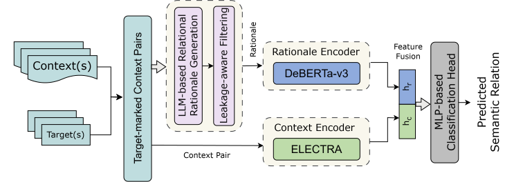

<div id="top"></div>

<br />

<div align="center">

  <h1 align="center">Relational Rationales from LLMs for Contextual Semantic Matching</h1>
  <p align="center">
    School of Science, Engineering & Technology, East Delta University, Chattogram, Bangladesh.
  </p>

 [Jannatul Naima](mailto:jannatulnaima.cse.cu@gmail.com) and Trina Chakraborty
</div>

Table of Contents

1. [About The Project](#about-the-project)
2. [Getting Started](#getting-started)
   - [Prerequisites](#prerequisites)
   - [Installation](#installation)
3. [Repository layout](#repository-layout)
4. [Data](#data)
5. [Reproduce results](#reproduce-results)
   - [1. Rationale generation](#1-rationale-generation)
   - [2. Leakage control](#2-leakage-control)
   - [3. Encoder training](#3-encoder-training)
   - [4. Fusion](#4-fusion)
   - [5. Evaluation](#5-evaluation)
6. [Results](#results)
7. [License](#license)
8. [Contact](#contact)
9. [References](#references)

## About The Project

Contextual semantic matching asks whether two lexical units mean the same thing in context. Transformer encoders solve this well, but the evidence they use stays implicit. This project asks whether natural-language **relational rationales** written by an LLM add useful and complementary information.
<p align="center">
  
</p>
The pipeline has four parts:

1. **Rationale generation.** Gemini 2.5 Flash describes how the target word or phrase is used in each sentence. The gold label is never shown to the model, and its own yes/no answer is discarded.
2. **Leakage control.** Words that are strongly associated with one label are found on the train split with informative-Dirichlet log-odds z-scores and removed from the rationales of every split.
3. **Independent encoders.** DeBERTa-v3-large reads the rationale and ELECTRA-large reads the marked context.
4. **Feature-level fusion.** The final-layer `[CLS]` vectors of the two frozen encoders are concatenated and classified by an MLP.

We evaluate on Word-in-Context (WiC) [1] and the Phrase Similarity task of Phrase-in-Context (PiC-PS) [2].

## Getting Started

### Prerequisites

- Anaconda 4.10 or higher
- Python 3.10 or higher
- A GPU for encoder training (we used a single NVIDIA T4 with FP16)
- Only to regenerate rationales: a Google Cloud project with Vertex AI, or an API key for an OpenAI-compatible endpoint that serves Gemini 2.5 Flash

### Installation

1. Clone the repo
   ```
   git clone https://github.com/jannatulnaima-duck/contextual-semantic-matching.git
   cd contextual-semantic-matching
   ```
2. Create and activate a Conda environment
   ```
   conda create -n rationales python=3.10
   conda activate rationales
   ```
3. Install the required libraries
   ```
   pip install -r requirements.txt
   ```

All commands below are run from the repository root.

## Repository layout

```
common/                shared task definitions, target marking, prediction files
rationale_generation/  prompts and two backends (Vertex AI batch, OpenAI-compatible)
leakage_control/       word ranking, threshold sweep, locked masking
classification/        single-encoder, context-only and rationale-only training
fusion/                the fusion head on the frozen encoders
evaluation/            McNemar tests
data/                  generated rationales and leakage-control outputs
```

## Data

| Task   | Hugging Face dataset | Train / validation / test |
|--------|----------------------|---------------------------|
| WiC    | [`Deehan1866/WiC_actual`](https://huggingface.co/datasets/Deehan1866/WiC_actual) | 5,428 / 638 / 1,400 |
| PiC-PS | [`Deehan1866/processed_phrase_similarity`](https://huggingface.co/datasets/Deehan1866/processed_phrase_similarity) | 7,004 / 1,000 / 2,000 |

`WiC_actual` differs from the original WiC release in a few columns:

| Original WiC          | WiC_actual         | Notes                                                        |
|-----------------------|--------------------|--------------------------------------------------------------|
| `phrase1` / `phrase2` | `word`             | one column; both occurrences are the same word               |
| `start` / `end` (char)| `start1`, `start2` | 0-indexed **word** positions (whitespace tokens), not characters |
| -                     | `pos`              | part of speech (`N`, `V`)                                    |
| `label` (int)         | `label` (bool)     | cast with `int(...)` before use                              |
| `idx`                 | -                  | none; ids are built as `wic-<split>-<row>`                   |

WiC sentences use spaced punctuation, so `sentence.split()` matches the stored positions. In PiC-PS each example has `phrase1`, `phrase2` and two sentences that differ only in the phrase; the phrase is found in its sentence by string search (whole word first, then prefix, ignoring case as a last resort). PS ids are `ps-<split>-<row>`. In both tasks the target is wrapped in `<TGT>...</TGT>`.

The rationales and the leakage-control outputs are included under `data/<task>/` for `wic` and `ps`:

| File                           | Contents                                                              |
|--------------------------------|-----------------------------------------------------------------------|
| `rationales.json`              | parsed Gemini rationales for every example, before leakage control    |
| `rationales_masked_locked.json`| the same rationales after masking at \|z\| > 3.0; used for training    |
| `leakage/ranked_words.json`    | candidate words ranked by \|z\| on the train split                     |
| `leakage/threshold_sweep.json` | probe accuracy for each masking threshold                             |
| `leakage/masking_manifest.json`| masked words and word counts per rationale                            |

Each rationale entry maps an example id to `{"rationale", "label", "parse_error"}`; the PS files also keep `sentence1_marked`, `sentence2_marked` and `alignment_ok`. The raw generation outputs are not tracked because they are large and contain the model's own yes/no answers.

## Reproduce results

### 1. Rationale generation

Skip this step if you only want to use the rationales in `data/`.

Rationales come from Gemini 2.5 Flash with extended thinking disabled and deterministic decoding. Model, temperature (0), token limit and thinking budget live in `rationale_generation/config.py`. The prompts for both tasks are in `rationale_generation/prompts.py`. Two backends write the same output layout, so a single parser handles both.

**Vertex AI batch jobs** (default)

```
export GOOGLE_CLOUD_PROJECT=<your project id>
export GCS_BUCKET=gs://<your bucket>
gcloud auth application-default login

bash rationale_generation/run_generation.sh wic vertex
bash rationale_generation/run_generation.sh ps vertex
```

This builds the batch requests (`prepare_requests.py`), uploads them and runs one batch job per split (`submit_batch.py`), downloads the outputs and writes `data/<task>/rationales.json` (`parse_responses.py`). Set `GEMINI_MODEL` or `GOOGLE_CLOUD_LOCATION` to change the model or region.

**OpenAI-compatible endpoint** (alternative)

```
export LLM_API_KEY=<your key>

bash rationale_generation/run_generation.sh ps openai
```

`generate_sync.py` sends one request at a time with retries and backoff. Each answer is appended to `output/<task>/<split>/responses.jsonl`, so an interrupted run resumes where it stopped. Set `LLM_BASE_URL` to use a different endpoint (default `https://lightning.ai/api/v1`).

Keep any service-account key outside the repository.

### 2. Leakage control

```
bash leakage_control/run_leakage_control.sh
```

For each task this
1. ranks words on the **train split only** by informative-Dirichlet log-odds z-score [3]. Target words (quoted words in WiC rationales, tokens inside the `<TGT>` spans in PS) are never candidates, and a word must be at least 2.5 times more frequent in one class than in the other (`sweep_threshold.py`),
2. measures how well a TF-IDF logistic-regression probe predicts the label from the masked rationale text for a range of thresholds,
3. locks the mask at |z| > 3.0 and applies the same word list to train, validation and test (`lock_masking.py`).

This masks 4 words for WiC and 12 for PiC-PS. The probe accuracy on the train split goes from 69.5% to about 67% on WiC and from 62.7% to about 62% on PiC-PS.

### 3. Encoder training

```
bash classification/run_train.sh wic
bash classification/run_train.sh ps
```

For the chosen task this trains, with seed 42 and early stopping (patience 3):

- the **rationale branch**: DeBERTa-v3-large on the masked rationale only (`train_rationale_only.py`; max length 128, batch size 16 x 2 accumulation steps, learning rate 1e-5, weight decay 0.01, warmup 10%),
- the **context branch**: ELECTRA-large on the marked sentence pair (`train_encoder.py --input_mode context`; max length 512, batch size 8 x 4 accumulation steps, learning rate 3e-6, weight decay 0.01, warmup 20%),
- the **single-encoder baselines**, which read context and rationale together (`--input_mode context_rationale`).

Checkpoints go to `checkpoints/` and the test predictions of every model to `results/predictions/`.

### 4. Fusion

```
bash fusion/run_fusion.sh wic
bash fusion/run_fusion.sh ps
```

Loads the two fine-tuned encoders, keeps them frozen, concatenates their final-layer `[CLS]` vectors (2,048 dimensions) and trains an MLP head with 512 hidden units, ReLU and dropout 0.1 at a learning rate of 1e-4.

### 5. Evaluation

```
bash evaluation/run_evaluation.sh wic
bash evaluation/run_evaluation.sh ps
```

`mcnemar_test.py` compares the fusion model with each branch using McNemar's test and reports how many test examples only one of the two gets right.

## Results

Test accuracy (%) reported in the paper.

| Configuration                          | WiC   | PiC-PS |
|----------------------------------------|-------|--------|
| Context-only (ELECTRA-large)           | 72.57 | 78.50  |
| Rationale-only (DeBERTa-v3-large)      | 75.50 | 79.30  |
| Fusion                                 | 75.21 | 81.60  |

Rationales are useful on both tasks, but they add to the context representation only on PiC-PS.

## License

Distributed under the MIT License. See `LICENSE`. The WiC and PiC data follow the licenses of the original datasets.

## Contact

Jannatul Naima, [jannatulnaima.cse.cu@gmail.com](mailto:jannatulnaima.cse.cu@gmail.com). Please email or open a GitHub issue if you have questions.

## References

[1] Mohammad Taher Pilehvar and Jose Camacho-Collados. 2019. WiC: the Word-in-Context Dataset for Evaluating Context-Sensitive Meaning Representations. NAACL-HLT.

[2] Thang Pham et al. 2023. PiC: A Phrase-in-Context Dataset for Phrase Understanding and Semantic Search. EACL.

[3] Burt L. Monroe, Michael P. Colaresi, and Kevin M. Quinn. 2008. Fightin' Words: Lexical Feature Selection and Evaluation for Identifying the Content of Political Conflict. Political Analysis.

[4] Pengcheng He, Jianfeng Gao, and Weizhu Chen. 2023. DeBERTaV3: Improving DeBERTa using ELECTRA-Style Pre-Training with Gradient-Disentangled Embedding Sharing. ICLR.

[5] Kevin Clark et al. 2020. ELECTRA: Pre-training Text Encoders as Discriminators Rather Than Generators. ICLR.

([back to top](#relational-rationales-from-llms-for-contextual-semantic-matching))
